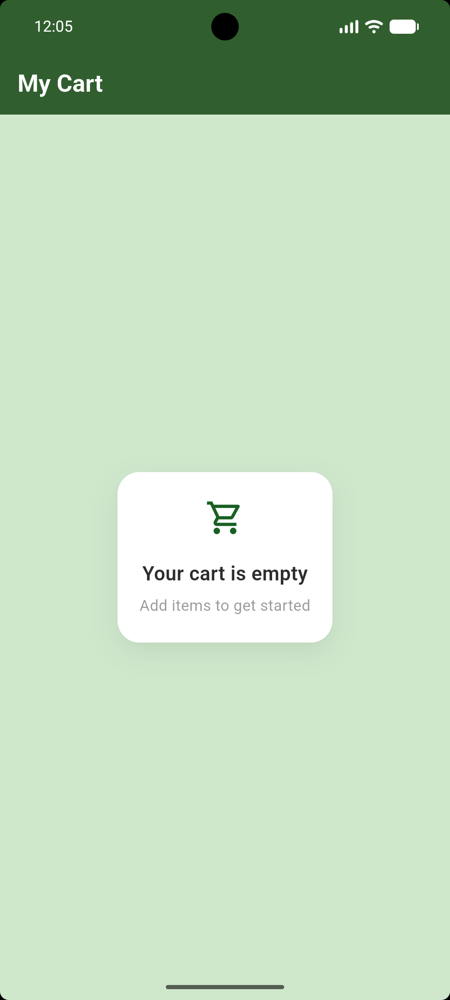
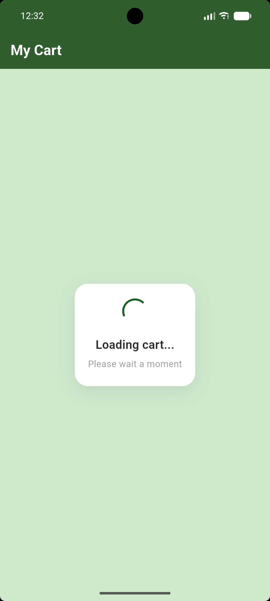

# Center Widget Demo 
Center is a flutter layout widget that positions its single child in the middle of the available space both horizontally and vertically 

## Real-world use case 
A loading screen 

##  How to run 

1. make sure Flutter is installed 
2. clone the repository 
  * git clone https://github.com/lilianeuwase2/center_widget_demo.git 
  * cd center_widget_demo
3. Run the app: `flutter run `

## Date of presentation 

Date: 14 October, 2026 

## Screenshot of the widget 

 